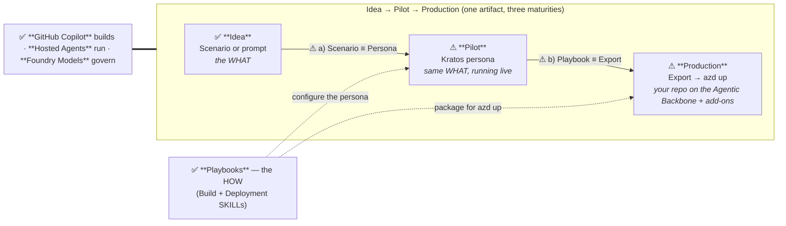

# Agentic Loop Portal — Workshop Flow

## Current customer-workshop flow

Use **Start a technical workshop** (`/workshop`) for a customer build conversation and **Show an industry demo** (`/scenarios`) for showcase. The workshop reuses Launchpad and the existing build hand-off.

Playbooks and workshop controls use the same architecture and capability catalogue. **Use in my workshop** preselects that playbook and adopts its requirements immediately. Other recommendations remain unchecked until explicitly included. Required choices are locked and identify their source playbook; remove a playbook using its chip or inclusion checkbox to release them. Independent choices and requirements shared with another included playbook remain selected. Inherited requirements never trigger further recommendations, so brief edits cannot indirectly build the architecture. Backing services such as Foundry IQ's search/storage and recipe-specific policy controls remain implementation details to validate during the build, not additional selectable catalogue entries.

1. Edit or replace the sample customer brief. Each fresh portal session randomly starts with one of three examples: HR policy answers, maintenance-system troubleshooting, or shared-room scheduling. The sample stays unchanged during navigation unless you edit it; clearing it leaves an empty field. Industry examples stay on the separate showcase route; a scenario's workshop link keeps its own editable context. Keep approved sample data ready. In **Select your architecture**, the **GitHub Copilot SDK, Hosted Agent and Foundry Models** backbone is always included. In Foundry Models, choose **Auto**, **GPT-6.1 Sol**, **GPT-6 Luna**, or **Claude Sonnet 5.5**. Auto asks Copilot to select a suitable model during the build, not in the portal; explicit choices require availability/quota validation and cannot be silently substituted. Select optional components under **Microsoft IQ**, **Skills + Tools**, **Control Plane**, and **Azure Foundation** by clicking or tapping a component box, or focusing it and pressing Space. Boxes show their inclusion status and selected styling without visible checkboxes; required components cannot be deselected. Hover over, focus, or tap an info icon for the description and a **Learn more** documentation link; this never toggles a component. Dismiss the info box with Escape or by clicking outside. The map keeps a stable layout, and brief edits or guide matching never select components. Describe custom requirements in the brief.
2. Prepare the workshop entirely in your browser using curated matching rules. **Proposed workshop approach** explains why each guide fits, what implementation material it provides, what needs adapting, and its prerequisites and exclusions, all visible without expandable panels. Explicitly including a guide adopts its required architecture and capabilities and adds its implementation instructions and recommended build skills to the Copilot prompt; it does not deploy or implement anything. Partial/no-match cases preserve covered guidance and surface gaps for explicit manual decisions in scope notes. There are no AI proposals, companion service or SDK calls in preparation. Add other guides through **Add another guide (optional)**; manual selection still needs customer validation. Including Threadlight selects its delivery workflow; choosing SDD or Rapid removes the conflicting Threadlight guide.
3. Use the compact **Review workshop** section: review the selected architecture and model, confirm who will use the pilot, define testable success criteria, and add scope notes or decisions. Model choice, agent capabilities and components travel into the confirmed specification and build prompt; this is not a deployment. Observability requires App Insights: its box is included and locked while Observability is on. Turning Observability off removes an automatically included App Insights choice, but preserves App Insights if you had selected it independently. The brief supplies the pilot scope; approved sample data, authorized access, verification evidence and production exclusions remain baseline requirements even when an optional product is not selected. Scope notes are optional for fully covered pilots but required to explicitly resolve gaps and open questions. Do not treat missing catalog coverage as infeasibility. The build workflow is a visible selector, not an expandable panel.
4. Select **Confirm scope & get prompt**. This single action confirms the current scope and opens the hand-off in this order: **Prepare your environment → Create your project → Your build prompt**. Already set up? Select **Your build prompt** directly. The button explains any missing users, success criteria or gap decisions. It does not run Copilot or deploy resources. Any edit invalidates confirmation and requires confirming again; unchanged scope can be reopened with **Open build prompt**. The confirmed scope and copied prompt use Markdown headings, prose and lists, not JSON. All specification fields and decisions remain included. Drafts survive navigation in memory, not refresh.
5. Use **GitHub Copilot App**. The [Foundry Agentic Loop plugin](https://github.com/github/awesome-copilot/tree/main/plugins/foundry-agentic-loop) is published in the awesome-copilot marketplace. Use **Customize → Plugins → foundry-agentic-loop → Install**, or `copilot plugin install foundry-agentic-loop@awesome-copilot` from Copilot CLI. This bundles the skill, canvas and workflow; no separate lean plugin, policy-skill install or Cockpit import is needed. Add your workspace and ask **open the agentic loop**. On Start, confirm **Rapid** for an existing Foundry project or **SDD** for a subscription and new project. The workflow selector preserves that choice in the confirmed scope and prompt. Threadlight remains an explicit alternate workflow, not silently replaced by SDD. Run supporting authentication in the build environment, including a sandbox; the canvas grants no permissions. Paste the full Markdown prompt into Chat. Return to **Your build prompt** after choosing run skills to copy the updated version.
6. Verify MVP behavior, access boundaries, safe data handling and failure paths. Capture evidence and remaining production work. Optional development deployment does not certify production readiness.

Model capabilities carry these candidate models into the build prompt only when selected. These are separate from the backbone's reasoning-model choice; availability, quota and feature support must be validated in the chosen Foundry project, and substitutions require confirmation. Real-Time Conversations and the voice-first playbook require true speech-to-speech with gpt-live-1, not a chained STT/reasoning/TTS pipeline. Select standalone TTS/STT independently when needed; neither implies the full voice-first playbook.

| Model capability | Model candidates |
| --- | --- |
| Image Generation | GPT-Image-2.5 or MAI-Image-2.6 |
| Text to Speech | MAI-Voice-2.1 or GPT-Audio |
| Speech to Text | MAI-transcribe-2 or GPT-transcribe |
| Real-Time Conversations | gpt-live-1 |

Use the [production portal](https://aka.ms/agentic-loop) for this flow; no repository clone, package installation or local development server is required. The portal cannot verify CLI/Azure readiness and does not provision or execute commands. Workshop preparation needs only the portal; no Copilot authentication or companion setup is required. Prepare subscription scopes, resource/RBAC rights, model availability and approved data before running the copied prompt in your project. Public static hosting and local development have the same preparation behavior. Copilot SDK build guidance remains available for the application being built, not as a portal runtime dependency.

### Model and agent capabilities

The two selector columns below the map separate **Model capabilities** (image generation, text to speech, speech to text and real-time conversations) from **Agent capabilities**. Image and speech features may need dedicated models alongside the selected reasoning model; they are requested capabilities, not a claim that every shortlisted model supports them.

**Human-in-the-Loop** comes first for approval gates. **Knowledge Grounding ↔ Foundry IQ** and **Domain-Specific Agents ↔ Skills** are synchronized in both directions, using a single underlying selection per pair. Skills supply reusable instructions and expertise for domain-specific tasks. **Multi-Agent Orchestration** remains a deliberate behavior choice and does not add Azure infrastructure automatically.

The workshop does not offer separate Content Safety, Key Vault, AI Search, Data Persistence, Storage, Forms Recognition or Workflow Automation selectors. Foundry IQ represents grounding at this level; implementation details and necessary safeguards are validated during the build, not silently added to the selected scope.

## Foundry Agentic Loop build contract

Workshop and Getting Started invoke the bundled `foundry-agentic-loop` build skill, not a runtime skill for the customer's agent. If a bundled component is missing, Copilot asks before reinstalling the plugin. It never installs extensions from a URL or edits Copilot settings. Re-enable disabled extensions in your extension settings and continue in a new session. Without the canvas, continue in Chat; without the workflow, SDD cannot start. Switching to Rapid requires confirmation and an existing Foundry project. Never fall back to `/spec2cloud`. Companion skills need installation approval. Existing legacy projects keep their mode until a switch is confirmed.

Rapid builds and verifies locally in an existing Foundry project. Deployment is separate and approved, using `az containerapp up`. SDD runs **Specify → Implement → Verify → Deploy** with planning and the frozen contract inside Specify. Each phase has a lead, fresh-context reviewer, evidence gate and bounded fix rounds. Use gated spec approval, and always pause before `azd up`; portal scope confirmation does not authorize deployment. RBAC and placement preflight run before resources are created; BLOCKED/ERROR stops the build, with all permission gaps reported together.

The mode lock lives in root `AGENTS.md`, while Azure settings live only in `.azure/deployment-plan.md`. Review the spec, deployment plan, verification evidence and SDD flight records in `.agentic-loop/runs/`. Resume journaled work rather than restarting completed phases. Verified lessons go in `docs/LOOP.md`; **improve the agentic loop** proposes measured changes requiring approval, never weaker gates. Preparation remains client-side and cannot verify external execution.

## Learn while building

Playbooks are teaching material, not just implementation links. They give the Solution Engineer context, a guided example and a concrete platform capability to explain to the customer. The proposal shows what each selected guide explores; the prompt hand-off links back to those playbooks.

For a first workshop on a topic, use the relevant playbook to walk through the approach, explain the design choices and demonstrate verification evidence. After learning it once, use the tailored prompt for subsequent builds without following every tutorial step again. Scope, permission and verification reviews still apply.

Curated starting points keep the workshop specific: connect the chosen capabilities to the customer's requirements instead of producing a generic app. The build prompt asks Copilot to explain these choices and leave a concise, repeatable walkthrough. If no playbook fits, teach the custom design and its limitations rather than substituting an unrelated example.

## Historical framing (not the implemented hand-off)

The following earlier discussion is retained only as historical context. Its Kratos persona/export proposal is retired, not an open implementation requirement: the reference integration, persona flow and portal links have been removed. Use the current customer-workshop flow above, not the diagram or proposed hand-offs below.

> The end-to-end flow to walk on screen using **only the Agentic Loop web portal**.
> ⚠ markers flag the steps that still depend on an **outstanding alignment/decision**.

## How to read this

This guide is **only the flow** to walk on screen, end to end. Status markers:

- ✅ **Stable** — ready to demo as-is.
- ⚠ **Needs refinement** — depends on an open alignment/decision (listed in *Outstanding alignment* at the end). Demo with a caveat or skip live.

## The flow

The single diagram to hold on screen for the whole session. It frames the **problem**, the **constant stack**, and the **standardized Idea → Pilot → Production path**.

### 1 · Frame the problem

> Pilots are cheap. Ungoverned production is expensive.
> The cure is **one standardized path that never changes shape** — from a first idea to a governed, observable, evaluated production agent.

### 2 · How we tackle it — the constant stack

Three things stay the same at **every** stage. They are the answer to "how", before any tool is opened:

| Layer | Role | Stays constant because… |
| --- | --- | --- |
| **GitHub Copilot** (SDK + SKILLs) | **Builds & orchestrates** the agent | The same SKILLs author code at every maturity. |
| **Foundry Hosted Agents** | **Run** the agentic loop in a governed runtime | The pilot and production agent share one runtime shape. |
| **Foundry Models** | **Govern** — models, evals, safety | Evals and policy follow the artifact from pilot to prod. |

### 3 · The standardized path — one artifact, three stages



> ⚠ The two dashed handoffs (**a** and **b**) are the parts of the flow that are **not yet aligned**. They work conceptually but are not wired in the portal — see *Outstanding alignment*.

**The one line the flow should deliver:**

> Pick a **Scenario** *(Idea)* → experience it as its **Kratos persona** *(Pilot)* → **export that persona** through the deployment playbooks to **`azd up`** *(Production)* — with **Copilot building, Hosted Agents running, Foundry Models governing** the whole way.

### 4 · Outstanding alignment — what each ⚠ in the flow is blocked on

These are the decisions that must close before the flow can be shown end-to-end without caveats.

| Flow point | ⚠ Open decision | Status | What it blocks |
| --- | --- | --- | --- |
| **Idea → Pilot** | **a) Scenario ≡ Persona** — do scenarios map 1:1 to Kratos personas (shared id, skills derived from tags → playbooks)? | Open | "Try live" and "Build" being the *same* artifact. Today personas are a separate catalog. |
| **Pilot → Production** | **b) Playbook ≡ Export** — is the Kratos/Agentic Backbone architecture the advisor's canonical run target, with Deployment SKILLs as its export checklist? | Open | One deploy story ending in `azd up`. Today export and advisor `azd up` are two paths. |
| **Pilot node** | **Kratos: live or mock?** — must Kratos be genuinely live for the audience, or is the current mock acceptable? | Open | Whether the Pilot stage can be demoed for real vs. narrated. |
| **Whole frame** | **Audience altitude** — GTM/exec (high-level) vs. field/technical (hands-on). | Open | How deep to go at each node; possibly two cuts of the flow. |
| **Production + beyond** | **Scope cut** — is Run/Scale in scope for this cut, or stop at first `azd up`? | Open | Whether the flow ends at Production or continues into the loop. |
| **All nodes** | **Narrative ratification** — is this Problem → Stack → Idea/Pilot/Production the one agreed spine? | Open | Everyone telling the same story; locks this diagram as canonical. |

### Fallback ASCII (if Mermaid won't render)

```
              ┌──────────────── constant stack ────────────────┐
              │ GHCP builds · Hosted Agents run · Foundry govern │
              └──────────────────────┬──────────────────────────┘
                                     │
   IDEA ───────────────►  PILOT ───────────────►  PRODUCTION
   Scenario / prompt      Kratos persona ⚠        Export → azd up ⚠
   (the WHAT) ✅          (same WHAT, live)        (Agentic Backbone + add-ons)
        ▲                      ▲                        ▲
        └── ⚠ a) same id ──────┘                        │
                               └── ⚠ b) playbooks = export checklist ──┘
                          Playbooks ✅ = the HOW (Build + Deploy SKILLs)
```
