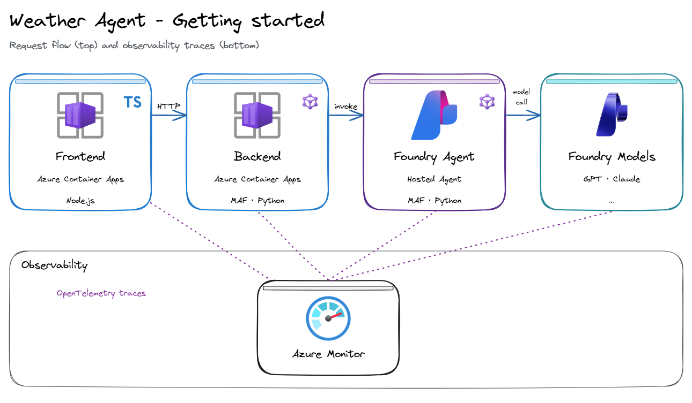
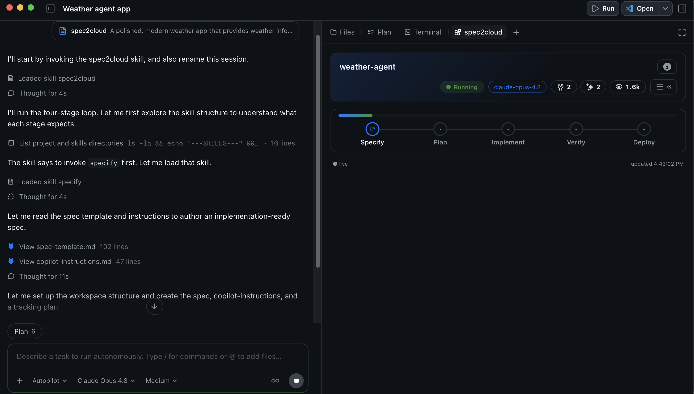
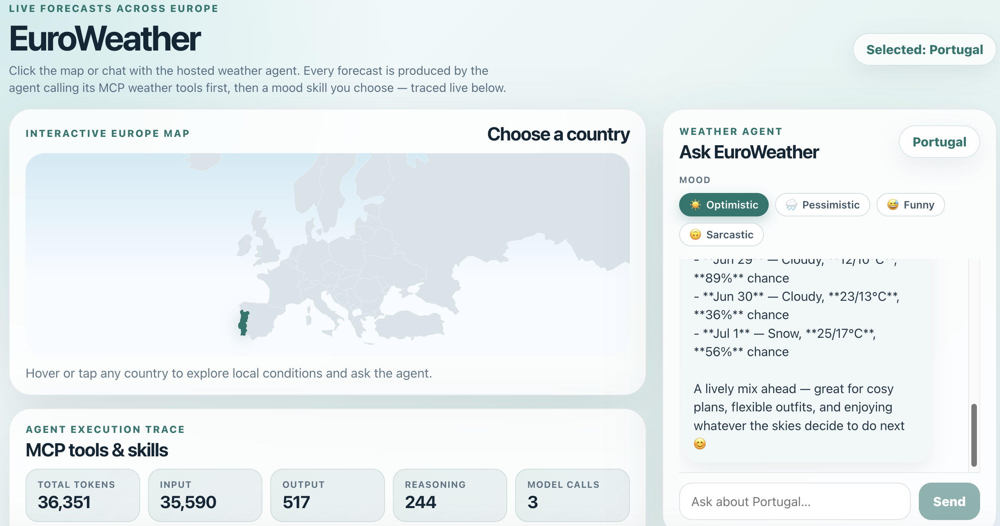
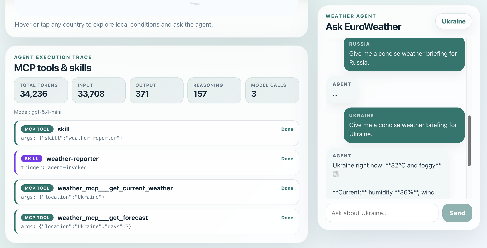
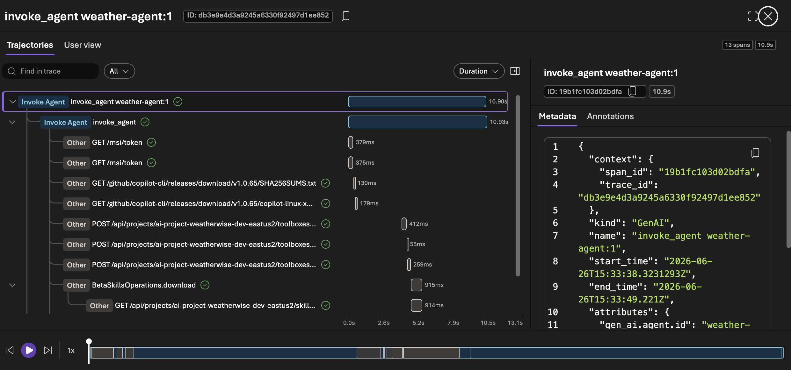

# Getting started on the Agentic Loop: Weather Agent

## Intro

### Getting started playbook

This playbook walks you through building a simple **weather agent** with the **Foundry Agentic Loop plugin**. One plugin bundles the build skill, canvas and evidence-gated SDD workflow.

The playbook is organized in three chapters:

- **Build** — go from a basic prompt to a working prototype for the weather agent.
- **Run** — operate the deployed agent and full-stack app with telemetry enabled.
- **Scale** — evolve the running solution and push changes through the loop, optionally unattended.

---

### What we will build

A chat-style web app where the user talks to a Foundry **hosted agent**. The agent uses an MCP server that returns randomized weather data — enough to exercise the full tool-call round-trip without any external API — plus an agent skill managed through a Foundry toolbox.



| Layer            | Choice for this skill-using agent                                        |
|------------------|------------------------------------------------------------------------------|
| Frontend         | React + Vite on Azure Container Apps                                         |
| Backend API      | Python + FastAPI on Azure Container Apps                                     |
| Agent            | Copilot SDK hosted in Microsoft Foundry                  |
| Tool             | Python based MCP server (random data)          |
| Observability    | OpenTelemetry → Application Insights (wired via Foundry)                     |
| Infra            | `azd` + Bicep (Azure Verified Modules)                                       |

Artifacts produced in your workspace mirror the four SDD phases. Planning is part of Specify:

| Stage      | Artifact                                            |
|------------|-----------------------------------------------------|
| Specify    | `./docs/spec.md` (requirements, contract, workstreams), `./.azure/deployment-plan.md` |
| Implement  | `./docs/implementation.md`, `./src/`, provisioned Azure dependencies |
| Verify     | `./docs/verify.md`, local E2E tests and agent evaluations |
| Deploy     | Deployed Azure endpoint, `./docs/deploy.md`         |

The mode lock lives in root `AGENTS.md`. SDD flight records live in `.agentic-loop/runs/`, and verified lessons in `docs/LOOP.md`. Azure settings stay only in `.azure/deployment-plan.md`.

---

### Setup

<!-- shared-playbook-setup:start -->
**Shared prerequisites for every playbook**

- An Azure subscription with resource-creation, role-assignment and Foundry data-plane permissions. Preflight checks all required scopes before resources are created; subscription Owner alone does not grant every Foundry data-plane role.
- A GitHub Copilot plan and the [GitHub Copilot App](https://gh.io/app), installed and signed in. Use App Chat for the build; the [Copilot CLI](https://github.com/features/copilot/cli/) is an alternative execution environment.
- [GitHub CLI (`gh`)](https://cli.github.com/) v2.90.0+ with `gh skill` available, [Azure CLI (`az`)](https://learn.microsoft.com/cli/azure/install-azure-cli), [Azure Developer CLI (`azd`)](https://learn.microsoft.com/azure/developer/azure-developer-cli/install-azd) with its Foundry extensions, Git, Node.js and Python 3.13. Approve missing-tool installations separately.

**Install once; reuse across playbooks.** In Copilot App, choose **Customize → Plugins**, find **foundry-agentic-loop**, then **Install**. The [published Foundry Agentic Loop plugin](https://github.com/github/awesome-copilot/tree/main/plugins/foundry-agentic-loop) bundles the build skill, canvas and SDD workflow. Do not separately install the bundled build skill, legacy policy skill, lean plugin or Cockpit.

Alternatively, install the plugin from Copilot CLI:

```bash
copilot plugin install foundry-agentic-loop@awesome-copilot
```

The **microsoft-foundry** companion skill is also required. Reuse an existing installation, including one supplied by the Azure plugin. Ask **open the agentic loop** in your project session; Copilot checks for the companion and asks before installing it if missing. For an approved manual installation, run this from your project folder, then reload skills or start a new session:

```bash
gh skill list
gh skill install microsoft/azure-skills microsoft-foundry --agent github-copilot --scope project
```

Run the install command only when the companion is missing. Build skills guide Copilot; runtime domain skills are separate and selected per playbook.

**Authenticate in the execution environment**, including when using a sandbox:

```bash
gh auth login
az login
azd auth login
```

Check the account, target subscription and tooling before building:

```bash
gh --version
gh auth status
gh skill list
az account show
azd version
azd auth login --check-status
```

**Open the bundled canvas.** Add your local folder or repository in Copilot App, start a project session and ask **open the agentic loop**. Check **Start** readiness and choose the intended mode. SDD starts from a subscription; Rapid requires an existing Foundry project. Alternative delivery playbooks such as Threadlight retain their own additional prerequisites and workflow. The canvas does not grant deployment permissions or replace Azure sign-in.

The screenshots show this portal's shared setup and project hand-off guidance, not proof that your local tools, plugin or Azure subscription are ready.


> Important: If a bundled component is missing, Copilot asks before reinstalling the plugin. It never installs extensions from a URL or edits Copilot settings. Re-enable disabled extensions in your extension settings and continue in a new session. Without the canvas, continue in Chat; without the workflow, SDD cannot start. Switching to Rapid requires confirmation and an existing Foundry project.

> Warning: Builds can create billable Azure resources. Confirm the scope, target, model availability and cost before provisioning or deployment. Review each playbook's scenario-specific prerequisites and cleanup instructions; do not delete pre-existing resources.
<!-- shared-playbook-setup:end -->

> **Heads up on cost.** This playbook provisions Container Apps, Foundry/AI Services and Application Insights. See [Clean up](#clean-up) before leaving resources running.

## Build

### Create a new project

Take an empty workspace through **Specify → Implement → Verify → Deploy** in SDD mode to produce a weather agent powered by a custom MCP server (random data) and runtime skills. For a quick local build in an existing Foundry project, choose Rapid instead; deployment remains separate and approved.

Create an empty folder to host the solution. A local folder gives the loop's artifacts (spec, plan, source, infra) a place to live.

```bash
mkdir weather-agent
cd weather-agent
```

> Want version control from minute one? Create a private GitHub repo
> instead:
> ```bash
> gh repo create weather-agent --private --clone
> cd weather-agent
> ```

The `foundry-agentic-loop` build skill comes with the plugin. It is not a run skill for the weather agent. It coordinates readiness, Foundry defaults and the chosen mode, and asks before installing the `microsoft-foundry` companion skill. Only add complementary services when the confirmed scope needs them.

---

### Open GitHub Copilot

Open **GitHub Copilot App**. The terminal commands above only prepare supporting tools and project files; the build prompt runs in App Chat. Review tool and deployment permissions before approving execution.

**1. Add your project.** Choose **+ → Add project from → Local folder or repository**, then select `weather-agent`.

**2. Open the agentic loop.** Ask this in Chat to open the bundled canvas. Its tabs are **Start**, **Build**, **Explore** and **Optimize**.

**3. Choose SDD on Start**, confirm your subscription, then use the prompt below. Rapid instead requires an existing Foundry project and produces a verified local app first. Copilot records the mode in `AGENTS.md`; switching modes needs confirmation.

---

### Run the build loop

Paste the following starter prompt:

```text
Use the foundry-agentic-loop skill in SDD mode to build a polished, modern weather app that provides weather information and forecasts through two interfaces: a visual SVG map of Europe or a chat interface. The app retrieves data from a custom MCP server, processes it through an integrated agent skill for specialized forecasting, and offers multiple forecasting styles—optimistic, pessimistic, and others—that users can select based on their preference. All features are fully functional except for the weather data, which is randomly generated for demonstration. The app includes a trace toggle that displays agent event information, such as the tools (input/output) and skills (skill.md content) used during forecasting.

Run the skill-owned read-only RBAC and placement preflight before creating resources. Report all permission gaps together and stop on BLOCKED or ERROR; do not grant permissions to bypass this gate. Confirm billable changes before making them.

Use foundry-agentic-loop-workflow: Specify → Implement → Verify → Deploy. Planning is part of Specify, not a separate Plan phase. Require spec approval and always pause before azd up. Respect any existing AGENTS.md mode lock; confirm a mode switch and keep Azure settings only in .azure/deployment-plan.md.

Freeze the implementation contract before parallel work and prove the minimal hosted integration first. Each SDD phase needs independent fresh-context review, evidence-based gates and bounded fix rounds. Preserve flight records in .agentic-loop/runs/ and verified lessons in docs/LOOP.md. Report missing bundled components and ask before reinstalling the plugin; never install extensions from a URL or edit Copilot settings. Ask the user to re-enable disabled extensions in their extension settings and start a new session. Without the canvas, continue in Chat; without the workflow, SDD cannot start. Offer Rapid only with user confirmation and an existing Foundry project.
```



> Tip: GitHub Copilot App supports voice dictation using a local modal to make it easier to write your prompts.

The **Build** tab shows progress and gates. A lead implements, an independent reviewer reruns checks, and bounded fix rounds either pass on evidence or pause for your decision. Spec approval and deployment approval are distinct. Execution time varies; do not treat a time estimate as a readiness guarantee.

For one phase or a range, ask Copilot to run `specify`, `implement`, `verify` or `deploy`; the workflow supports `from` and `to`. Ask to `resume` a paused run instead of repeating completed work. Deployment approval is tied to the spec, plan, verify report and Azure target; changed inputs require fresh approval.

After completion, use **Explore** and the verified endpoint to exercise the app. Open Foundry to inspect agents, models, toolboxes and traces.

---

### Troubleshooting

| Symptom | Likely cause | Fix |
|---------|--------------|-----|
| Canvas or workflow is missing | Bundled component unavailable | Ask before reinstalling the plugin; do not install extensions from a URL or edit Copilot settings |
| Canvas or workflow is disabled | An extension was disabled in an earlier session | Re-enable it and continue in a new session |
| Gate remains blocked | Evidence check failed or permissions are missing | Inspect all reported issues, fix and verify, then ask to resume; never weaken the gate |
| `azd` fails with an auth or subscription error | Wrong tenant or subscription selected | Run `azd auth login`, then `az account set --subscription <id>` |
| Deploy fails on quota or region | Model capacity unavailable in the chosen region | Reconcile the deployment plan with the placement check and request fresh approval before `deploy` |
| The agent replies but no traces appear | Looking too early | Spans take a few seconds to land in Application Insights — refresh the **Traces** view |

---

## Run

### Run the Agentic Loop

Open the weather frontend and send a few prompts (e.g. *"What's the weather in Madrid?"*). Each turn is part of a conversation with the hosted agent running on Foundry.



> The picture above illustrates a previous run using the same prompt. Most likely you will get different results. To match a specific look and feel, paste a screenshot of an existing web site and ask Copilot to match it.

---

### Check the trace information

Copilot SDK emits events on which tools and skills it has used.



---

### Observe traces

OpenTelemetry into one Application Insights resource is part of the plugin's defaults. Verify correlated spans from the backend, agent, tools and model calls rather than assuming instrumentation succeeded. Keep sensitive content capture off unless approved with redaction and retention controls.

Use the canvas to open the hosted agent in the Foundry project, then click **Traces**. Inspect a trace to see exactly what the agent did on each turn — the model call, the `get_weather` tool invocation, and the response — end to end.



---

## Scale

### Take it further

You built, ran, and scaled a full-stack agent without hand-writing the spec, infrastructure, or glue code. From here:

- **Customize the agent** — change its instructions, add tools, or swap the model, then push the change through the loop.
- **Explore the other playbooks** — apply the same loop to richer, production-grade scenarios.

Ask **improve the agentic loop** to mine `docs/LOOP.md` and flight records for evidence-backed skill and workflow improvements. Changes are measured against the base commit and applied only after approval; approvals, RBAC, safety and evidence gates are never weakened.

---

### Clean up

Review the exact environment and subscription, then explicitly approve teardown before running this from the SDD project root, where `azure.yaml` lives:

```bash
azd down --purge --force
```

`--purge` also removes soft-deleted resources. Entra app registrations live outside the resource group: review the build-created registrations in `docs/implementation.md` and approve their removal separately. For Rapid, do not tear down the pre-existing Foundry project.
