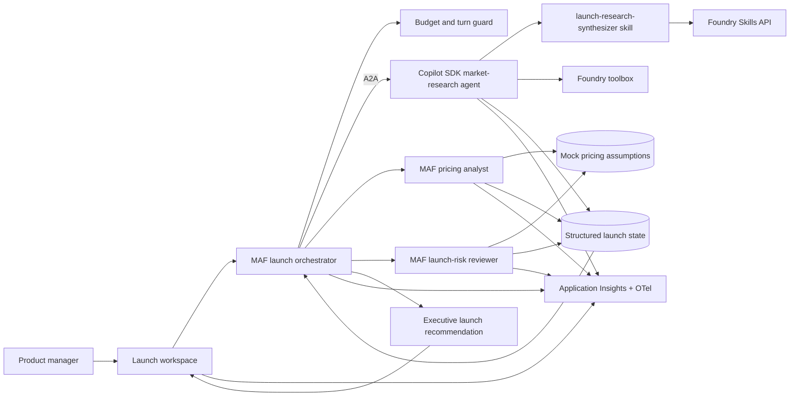

# Multi-Agent Orchestration: Product Launch Command Center

## Intro

### Product launch command center playbook

This playbook builds a **Product Launch Command Center** for a fictional bicycle company, Northstar Bikes. A product manager submits a launch brief for a new e-bike, and a Microsoft Agent Framework workflow coordinates specialist agents that research the market, model pricing, review launch risks, and assemble an executive recommendation.

**Use when:** A business workflow needs specialized agents built with different frameworks to collaborate through governed contracts.

**Core tech stack:** Microsoft Agent Framework, GitHub Copilot SDK, Foundry Hosted Agents, Foundry Skills API, A2A, Foundry Models

The **MAF launch orchestrator** owns the graph and fan-out/fan-in workflow. It calls a **Copilot SDK market-research agent** over Foundry A2A and two MAF specialists: a pricing analyst and a launch-risk reviewer. The Copilot SDK specialist must use the `launch-research-synthesizer` skill, which is authored locally, versioned through the Foundry Skills API, promoted to `default_version`, and downloaded into its runtime skill directory.

The playbook is organized in three chapters:

- **Build** — generate the mock launch packet, heterogeneous agents, orchestration graph, and governed skill.
- **Run** — submit launch decisions and inspect per-agent, A2A, skill, and budget telemetry.
- **Scale** — add specialists, stronger hand-off contracts, and production data sources.

---

### What we will build

A chat-style launch workspace where a product manager submits the Northstar **Aurora e-bike** launch packet. A MAF orchestrator fans out work to three hosted specialists, then combines their structured outputs into a recommendation with positioning, price range, risks, evidence, and unresolved decisions.



| Layer | Choice for this scenario | Why |
|---|---|---|
| Frontend | React + Vite on Azure Container Apps | Simple surface to submit tasks and watch hand-offs. |
| Backend API | Python + FastAPI on Azure Container Apps | Hosts the orchestration entrypoint and session state. |
| Orchestrator | Microsoft Agent Framework workflow | Owns the graph, fan-out/fan-in, budgets, and structured aggregation. |
| Market research | GitHub Copilot SDK hosted agent over A2A | Uses the governed `launch-research-synthesizer` skill for evidence synthesis. |
| Pricing and risk | Microsoft Agent Framework hosted agents | Produce typed pricing and risk outputs from the mock launch packet. |
| Model | Foundry Models | Keeps model usage and capacity on the Foundry platform. |
| Skill lifecycle | Foundry Skills API + toolbox | Versions, promotes, and distributes the research skill without baking it into the image. |
| Agent composition | Foundry A2A | Lets the MAF orchestrator call the Copilot SDK specialist as a governed remote agent. |
| Shared memory | Session/state store passed across hand-offs | Carries context so executors don't re-derive it. |
| Observability | OpenTelemetry → Application Insights (wired via Foundry) | Per-agent traces, token usage, and hand-off spans. |
| Infra | `azd` + Bicep (Azure Verified Modules) | Reproducible provisioning of the whole topology. |

**Done means:**

- A single user request is decomposed by the planner and routed to the right executor(s).
- The MAF orchestrator coordinates at least two MAF specialists and one Copilot SDK specialist.
- Hand-offs pass structured context, not raw chat history dumps.
- Shared memory lets an executor build on another's output.
- Each turn stays within its token and tool-call budget.
- The Copilot SDK specialist downloads and follows the promoted `launch-research-synthesizer` skill version.
- Every agent, hand-off, and tool call is visible as a span in Application Insights.

**Out of scope for the first build:**

- Live market, CRM, or finance data — the first build uses a committed mock launch packet.
- More than three specialists — add roles only after the hand-off contracts are stable.
- Private networking — a production hardening step, not the first run.
- Long-lived durable workflows — add durable orchestration once the topology is stable.

---

### Setup

<!-- shared-playbook-setup:start -->
**Shared prerequisites for every playbook**

- An Azure subscription with resource-creation, role-assignment and Foundry data-plane permissions. Preflight checks all required scopes before resources are created; subscription Owner alone does not grant every Foundry data-plane role.
- A GitHub Copilot plan and the [GitHub Copilot App](https://gh.io/app), installed and signed in. Use App Chat for the build; the [Copilot CLI](https://github.com/features/copilot/cli/) is an alternative execution environment.
- [GitHub CLI (`gh`)](https://cli.github.com/) v2.90.0+ with `gh skill` available, [Azure CLI (`az`)](https://learn.microsoft.com/cli/azure/install-azure-cli), [Azure Developer CLI (`azd`)](https://learn.microsoft.com/azure/developer/azure-developer-cli/install-azd) with its Foundry extensions, Git, Node.js and Python 3.13. Approve missing-tool installations separately.

**Install once; reuse across playbooks.** In Copilot App, choose **Customize → Plugins**, find **foundry-agentic-loop**, then **Install**. The [published Foundry Agentic Loop plugin](https://github.com/github/awesome-copilot/tree/main/plugins/foundry-agentic-loop) bundles the build skill, canvas and SDD workflow. Do not separately install the bundled build skill, legacy policy skill, lean plugin or Cockpit.

Alternatively, install the plugin from Copilot CLI:

```bash
copilot plugin install foundry-agentic-loop@awesome-copilot
```

The **microsoft-foundry** companion skill is also required. Reuse an existing installation, including one supplied by the Azure plugin. Ask **open the agentic loop** in your project session; Copilot checks for the companion and asks before installing it if missing. For an approved manual installation, run this from your project folder, then reload skills or start a new session:

```bash
gh skill list
gh skill install microsoft/azure-skills microsoft-foundry --agent github-copilot --scope project
```

Run the install command only when the companion is missing. Build skills guide Copilot; runtime domain skills are separate and selected per playbook.

**Authenticate in the execution environment**, including when using a sandbox:

```bash
gh auth login
az login
azd auth login
```

Check the account, target subscription and tooling before building:

```bash
gh --version
gh auth status
gh skill list
az account show
azd version
azd auth login --check-status
```

**Open the bundled canvas.** Add your local folder or repository in Copilot App, start a project session and ask **open the agentic loop**. Check **Start** readiness and choose the intended mode. SDD starts from a subscription; Rapid requires an existing Foundry project. Alternative delivery playbooks such as Threadlight retain their own additional prerequisites and workflow. The canvas does not grant deployment permissions or replace Azure sign-in.

The screenshots show this portal's shared setup and project hand-off guidance, not proof that your local tools, plugin or Azure subscription are ready.


> Important: If a bundled component is missing, Copilot asks before reinstalling the plugin. It never installs extensions from a URL or edits Copilot settings. Re-enable disabled extensions in your extension settings and continue in a new session. Without the canvas, continue in Chat; without the workflow, SDD cannot start. Switching to Rapid requires confirmation and an existing Foundry project.

> Warning: Builds can create billable Azure resources. Confirm the scope, target, model availability and cost before provisioning or deployment. Review each playbook's scenario-specific prerequisites and cleanup instructions; do not delete pre-existing resources.
<!-- shared-playbook-setup:end -->

**Scenario-specific prerequisites:** Validate heterogeneous-agent, Microsoft Agent Framework and A2A support for the selected Foundry environment. This build can provision multiple hosted agents, Container Apps and Application Insights. See [Clean up](#clean-up).

## Build

### Create a new project

Take an empty workspace through the **Specify → Implement → Verify → Deploy** loop and produce the Northstar launch command center.

```bash
mkdir multi-agent-orchestration
cd multi-agent-orchestration
```

> Want version control from minute one? Create a private GitHub repo instead:
> ```bash
> gh repo create multi-agent-orchestration --private --clone
> ```

---

### Open GitHub Copilot

This playbook uses the **GitHub Copilot App** and its bundled Foundry Agentic Loop canvas; the workflow also runs in Copilot CLI.

> **Using the CLI instead?** Run `copilot --allow-all` only in a sandbox workspace, or omit the flag to approve each action.

**1. Add your project.** Choose **+ -> Add project from -> Local folder or repository**, then select `multi-agent-orchestration`.

**2. Open the bundled canvas.** In your project session, ask **open the agentic loop**. Choose **SDD** on Start and confirm the subscription. Planning is inside Specify; the other tabs are Build, Explore and Optimize. Rapid is an alternative for an existing project, with local verification before a separately approved deployment.


**3. Choose a model and mode.**

| Mode | Behavior |
|---|---|
| Interactive | Step-by-step collaboration; you confirm each stage |
| Plan | Plans first, executes once you approve |
| Autopilot | Automates work, but the SDD workflow still pauses at the spec and deployment approval gates |

---

### Run the build loop

Paste this starter prompt:

```text
Use the foundry-agentic-loop skill in SDD mode to build a Product Launch Command Center for the fictional company Northstar Bikes. A product manager submits the launch packet for the Aurora e-bike and receives an executive recommendation covering target segments, positioning, evidence, price range, launch risks, mitigations, and unresolved decisions.

Use the `foundry-agentic-loop` skill and `foundry-agentic-loop-workflow`. Require spec approval and always pause before `azd up`. Confirm billable changes, run RBAC and placement preflight before creating resources, and stop on BLOCKED or ERROR. Freeze the contract in Specify and prove the minimal hosted integration before parallel work. Keep Azure settings only in `.azure/deployment-plan.md`, respect the `AGENTS.md` mode lock, and preserve evidence, `.agentic-loop/runs/` flight records and `docs/LOOP.md` lessons.

Implement the orchestration as a Microsoft Agent Framework graph with a MAF launch orchestrator that fans out to three hosted specialists and aggregates typed results. The pricing analyst and launch-risk reviewer must also be MAF agents. The market-research specialist must be a separate GitHub Copilot SDK hosted agent exposed to the orchestrator through Foundry A2A. Do not combine MAF and Copilot SDK inside one agent.

Create a realistic mock launch packet under data/northstar-aurora-launch with product specifications, customer interview excerpts, competitor snapshots, pricing assumptions, channel constraints, and a seed risk register. Author skills/launch-research-synthesizer/SKILL.md to instruct the Copilot SDK specialist how to rank evidence, separate facts from assumptions, cite mock source files, and produce the typed research hand-off. Create an immutable version through the Foundry Skills API, promote it to default_version, attach it to the research toolbox, and download the governed copy into the Copilot SDK agent's writable runtime skill directory before each session. Include evals that prove the skill was loaded and followed.

Cap tokens, tool calls, and A2A calls per launch run. Include a trace view for the MAF workflow, every specialist, A2A hand-offs, skill name/version, toolbox calls, and final aggregation.
```

> Foundry Skills and A2A are preview capabilities. Opt in explicitly (for example, `allow_preview=True`) and fail visibly if publication, promotion, download, or A2A registration does not succeed.

> `foundry-agentic-loop-workflow` runs the same four-phase SDD loop as Getting Started. The prompt explicitly invokes `foundry-agentic-loop`; the remaining requirements define the MAF graph, heterogeneous specialists, governed skill, A2A hand-off, shared state, and budget controls.

> For one phase or a range, ask Copilot to run `specify`, `implement`, `verify` or `deploy`; the workflow supports `from` and `to`. Planning is part of Specify. Each phase has fresh-context review and bounded fix rounds; a failed gate pauses with evidence. Ask to `resume` paused work instead of repeating completed steps.

Use these recommended answers if Copilot asks clarifying questions:

| Question area | Recommended answer |
|---|---|
| Topology | Planner-executor with explicit hand-offs. |
| Orchestrator | MAF graph workflow with fan-out/fan-in and typed state. |
| Specialists | Copilot SDK market research; MAF pricing; MAF launch risk. |
| Cross-framework call | Foundry A2A from the MAF orchestrator to the Copilot SDK agent. |
| Runtime skill | `launch-research-synthesizer`, consumed only by the Copilot SDK specialist. |
| Mock data | Committed Northstar Aurora launch packet; no external market API. |
| Shared state | Session-scoped shared memory passed across hand-offs. |
| Budget control | Per-turn token and tool-call caps with a guard that stops runaway loops. |
| Tools | MCP servers published through a Foundry toolbox. |

When the skill finishes, review `docs/spec.md` for these must-have requirements: MAF orchestration graph, two MAF specialists, one Copilot SDK A2A specialist, typed hand-offs, mock launch packet, per-run budget guard, Foundry Skills API lifecycle, runtime skill download, and end-to-end tracing.

---

### Review the generated plan

Turn the spec into a reviewable implementation and deployment plan.

```text
Review the Specify artifacts and frozen implementation contract before implementation.
```

The deployment plan should include:

| Section | What good looks like |
|---|---|
| Resource graph | Foundry project, MAF orchestrator, two MAF specialists, Copilot SDK specialist, A2A endpoint, toolbox, skill version, models, identity, Application Insights, ACA apps. |
| RBAC | Least-privilege roles for Foundry, telemetry, and any state store. |
| Orchestration | MAF fan-out/fan-in graph, A2A call, typed state, hand-off schemas, and aggregation strategy. |
| Budget | Token and tool-call caps per turn, plus the guard's stop behavior. |
| Skill lifecycle | Author, version, evaluate, promote, attach, download, trace, and roll back `launch-research-synthesizer`. |
| azd template | `minimal` / `azd init --minimal`. |

Review `docs/spec.md` and `.azure/deployment-plan.md` before continuing.

---

### Review the implementation

Generate the source and infrastructure from the plan.

```text
/implement
```

Expected generated artifacts:

```text
.
├── azure.yaml
├── infra/
├── src/
│   ├── frontend/                 # chat UI with hand-off trace view
│   ├── backend/                  # orchestration entrypoint + session state
│   └── agents/
│       ├── launch-orchestrator/  # MAF workflow + aggregation
│       ├── market-research/      # Copilot SDK + A2A + governed skill
│       ├── pricing-analyst/      # MAF specialist
│       └── launch-risk/          # MAF specialist
├── skills/
│   └── launch-research-synthesizer/
│       └── SKILL.md
├── data/
│   └── northstar-aurora-launch/  # mock launch packet
└── docs/
```

The implementation should wire:

1. **MAF workflow** — the orchestrator fans out to pricing, risk, and market research, then aggregates typed results.
2. **Heterogeneous agents** — pricing and risk use MAF; market research uses Copilot SDK and is called over A2A.
3. **Governed skill** — create and promote `launch-research-synthesizer` through the Foundry Skills API, attach it to the toolbox, and download it before the Copilot session starts.
4. **Hand-offs and state** — pass typed launch evidence, pricing, and risk objects rather than raw chat history.
5. **Budget and telemetry** — cap tokens/tool/A2A calls and trace every agent, skill version, hand-off, and aggregation.

Commit a checkpoint once the diff looks right:

```bash
git add .
git commit -m "feat: scaffold multi-agent orchestration"
```

---

### Verify locally

Validate locally against real Azure dependencies.

```text
/verify
```

| Test | Action | Expected result |
|---|---|---|
| Decomposition | Submit the Aurora launch packet. | MAF orchestrator fans out to all three specialists. |
| Cross-framework | Inspect the market-research call. | MAF invokes the Copilot SDK agent through A2A. |
| Skill use | Ask for evidence-backed positioning. | Trace shows the promoted `launch-research-synthesizer` version and cited mock files. |
| MAF specialists | Inspect pricing and risk outputs. | Both are typed results from MAF agents. |
| Hand-off | Inspect the payload passed to an executor. | Structured context, not a raw chat dump. |
| Shared memory | Have one executor consume another's output. | Second executor builds on the first without re-deriving it. |
| Budget cap | Submit a task that would loop. | The guard stops the turn at the configured cap. |
| Aggregation | Review the final answer. | One coherent response, not stitched fragments. |
| Telemetry | Query Application Insights. | Per-agent, hand-off, and tool spans are visible. |

---

### Deploy

Deploy after local verification passes.

```text
/deploy
```

Deployment readiness checklist:

- [ ] Each hosted agent has a valid `agent.yaml` and, where used, `code_configuration`.
- [ ] MAF orchestrator calls the Copilot SDK specialist through a verified A2A endpoint.
- [ ] Pricing and risk specialists are MAF agents with typed contracts.
- [ ] `launch-research-synthesizer` has an immutable Foundry skill version, promoted `default_version`, and rollback target.
- [ ] Copilot SDK startup downloads the governed skill into a writable runtime directory and configures `skill_directories`.
- [ ] Budget guard limits are set from configuration, not hardcoded.
- [ ] `.agentignore` and per-service `.dockerignore` exclude local build artifacts.
- [ ] Container app names respect the 32-character Azure Container Apps limit.
- [ ] Decomposition, hand-off, and budget-cap tests pass.
- [ ] Application Insights receives per-agent telemetry.

After approved deployment, Copilot reports the verified frontend URL. Use Explore to exercise the app and the Foundry portal to inspect agents, models, tools and correlated traces.

---

### Troubleshooting

| Symptom | Likely cause | Fix |
|---|---|---|
| Planner never delegates | Roles or routing criteria are vague | Make each executor's responsibility and hand-off contract explicit in the spec. |
| Agents repeat work | Shared state is missing or unstructured | Pass typed hand-off fields and persist session-scoped state. |
| A turn exceeds budget | Guard limits are not enforced centrally | Enforce token and tool-call caps before each hand-off and tool call. |
| Traces stop at the planner | Context is not propagated | Carry the trace context through every hosted-agent and MCP invocation. |

## Run

### Run the orchestration

Open the deployed app and submit the Northstar Aurora launch packet. Confirm that the MAF workflow invokes the pricing and risk MAF agents plus the Copilot SDK research agent, the research trace names the governed skill version, and the final launch recommendation stays within budget.

---

### Observe

Use telemetry to understand whether the topology is healthy, on-budget, and coordinating correctly.

Track:

- Per-agent request count, latency, and failures.
- Hand-off count and hand-off failures per turn.
- Token usage and tool-call count against the per-turn budget.
- Planner routing decisions and mis-routes.
- Shared-memory read/write errors.

Useful Application Insights questions:

| Question | Signal |
|---|---|
| Is the planner routing correctly? | Routing decision traces vs. executor invoked. |
| Are we over budget? | Token/tool-call counts against the configured caps. |
| Where is latency spent? | Span durations per agent and per hand-off. |
| Are hand-offs reliable? | Hand-off success rate and retry counts. |

### Evaluate

Create a small evaluation set before broad rollout.

| Eval | Dataset shape | Pass condition |
|---|---|---|
| Routing accuracy | Launch request, expected specialists | MAF orchestrator selects the correct specialists. |
| Framework boundary | Launch request, expected runtime | Research uses Copilot SDK; pricing and risk use MAF. |
| Skill adherence | Research task, mock evidence, expected citations | Copilot specialist follows the governed skill and cites source files. |
| Hand-off fidelity | Task, expected context fields | Executor receives the required structured context. |
| Answer quality | Task, reference answer | Aggregated answer matches the reference intent. |
| Budget adherence | Task designed to loop | Turn stops within the configured cap. |
| Latency | Representative tasks | p95 latency stays within the pilot target. |

### Iterate

Safe iteration loop:

1. Adjust planner routing rules, hand-off contract, or budget caps.
2. Re-run routing and hand-off evals.
3. Review per-agent traces and token usage.
4. Commit a checkpoint before changing prompts or topology.

```bash
git add .
git commit -m "chore: tune planner routing and budget caps"
```

## Scale

### Add more specialists

Add one executor at a time. For each new role: define its hand-off contract, register its tools on the shared toolbox, and add a routing rule to the planner. Re-run routing evals before promoting.

---

### Harden coordination

- Make hand-offs idempotent so retries don't duplicate work.
- Add fallbacks when an executor fails or times out.
- Consider Microsoft Agent Framework graph/workflow orchestration when the topology outgrows simple planner routing.
- Add durable orchestration for long-running, multi-turn tasks.

---

### Promote across environments

Use separate azd environments per stage:

```bash
azd env new multi-agent-orchestration-test-eus2
azd env new multi-agent-orchestration-prod-eus2
```

Promotion checklist: explicit RBAC per environment, evals run before promotion, budget caps reviewed, and telemetry dashboards in place before production rollout.

---

### Take it further

- **Customize the topology** — change routing, add a critic agent, or swap models per role, then push the change through the loop.
- **Explore the other playbooks** — apply the same loop to grounding, governance, and evaluation scenarios.

> Tip: run the loop fully unattended for larger changes:
> ```bash
> copilot -p "Use the foundry-agentic-loop skill in SDD mode to <your next big idea>" --no-ask-user --yolo -- autopilot
> ```

---

### Clean up

When you are done experimenting, delete every Azure resource the loop created. Run this from the project root, where `azure.yaml` lives:

```bash
azd down --purge --force
```

`--purge` also removes soft-deleted resources (such as the Foundry/AI Services account and Key Vault) so their names are immediately reusable.

---

### References

- [Microsoft Agent Framework](https://learn.microsoft.com/agent-framework/)
- [What are Foundry Agents?](https://learn.microsoft.com/azure/ai-foundry/agents/overview)
- [Connect tools to Foundry agents](https://learn.microsoft.com/azure/ai-foundry/agents/how-to/tools/overview)
- [Model Context Protocol (MCP)](https://modelcontextprotocol.io/)
- [Observability for generative AI applications](https://learn.microsoft.com/azure/ai-foundry/concepts/observability)
