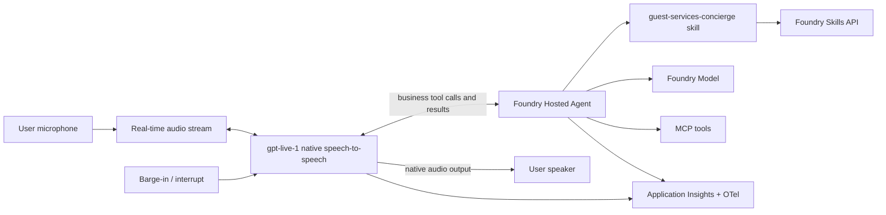
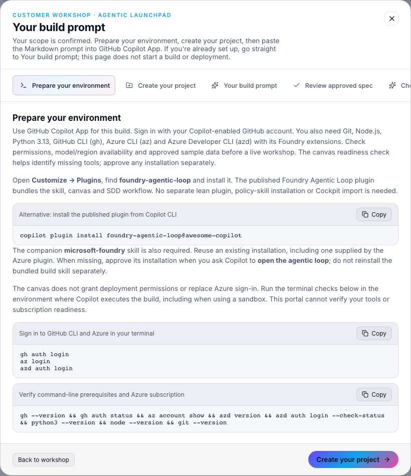
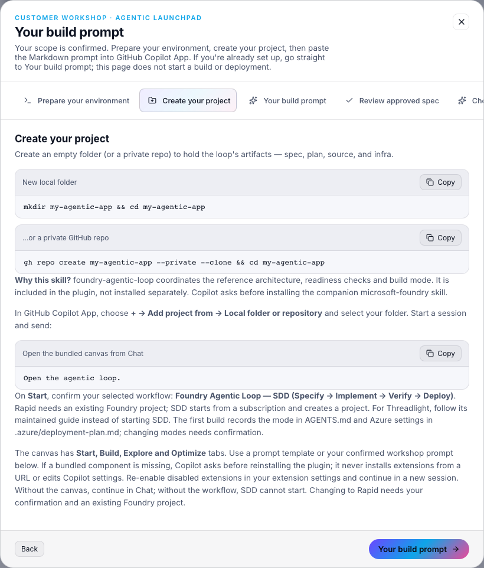

# Voice-First Agent Blueprint: Hotel Concierge

## Intro

### Build a low-latency voice concierge for a fictional hotel.

This playbook builds **Harbor**, a voice concierge for the fictional Woodgrove Hotel. Guests ask about breakfast, accessibility, amenities, local transport, and simple service requests. Harbor responds in real time, supports barge-in, and escalates safety, medical, billing, and complaint scenarios to hotel staff.

**Use when:** Your experience is spoken or real-time conversational, not text-first.

**Core tech stack:** gpt-live-1 native speech-to-speech, Copilot SDK, Foundry Hosted Agents, Foundry Skills API, Foundry Models

The agent consumes a `guest-services-concierge` skill that defines the spoken response style, hotel facts, tool boundaries, confirmation rules, and staff escalation behavior. The skill is versioned and promoted through the Foundry Skills API, downloaded to writable runtime storage, and loaded into every Copilot SDK session.

The playbook is organized in three chapters:

- **Build** — go from a prompt to a working streaming voice prototype.
- **Run** — operate the deployed experience with latency and turn telemetry.
- **Scale** — tune latency, add languages, and push changes through the loop.

---

### What we will build

A browser app where a Woodgrove guest speaks and hears Harbor reply in real time. The `gpt-live-1` model consumes and produces audio directly; do not implement this as a chained speech-to-text, text-reasoning and text-to-speech pipeline. The hosted Copilot SDK agent follows the governed `guest-services-concierge` skill for business procedures and tool calls, and mock hotel data powers amenity answers and service requests. Validate the voice-session/tool bridge against the chosen Foundry deployment before expanding the app. Every turn traces latency, interruption, skill version, and escalation.

Selecting this playbook adopts **Real-Time Conversations** and **Human-in-the-Loop** for service-action confirmations and staff escalation, not the standalone **Text to Speech** or **Speech to Text** capabilities. For a synthesis-only scenario, select Text to Speech with **MAI-Voice-2.1 or GPT-Audio**. For a transcription-only scenario, select Speech to Text with **MAI-transcribe-2 or GPT-transcribe**. Those independent features do not imply this full voice-first playbook. Validate model availability, quota, protocols and feature support in the chosen Foundry project; do not silently substitute another model or a chained pipeline.



| Layer | Choice for this scenario | Why |
|---|---|---|
| Frontend | React + Vite on Azure Container Apps | Captures mic audio and plays streamed speech. |
| Backend API | Python + FastAPI on Azure Container Apps | Bridges the audio stream and the agent session. |
| Voice | gpt-live-1 native speech-to-speech | Direct audio input/output with streaming and barge-in; no chained STT/TTS pipeline. |
| Agent | Copilot SDK hosted in Microsoft Foundry | Governed runtime that streams partial results. |
| Runtime skill | Foundry Skills API | Versions and distributes `guest-services-concierge`. |
| Model | Foundry Models | Frontier reasoning on the Foundry platform. |
| Tools | Python MCP servers via a Foundry toolbox | Governed tool access during a spoken turn. |
| Observability | OpenTelemetry → Application Insights (wired via Foundry) | Per-turn latency and interruption spans. |
| Infra | `azd` + Bicep (Azure Verified Modules) | Reproducible provisioning with keyless identity. |

**Done means:**

- A user can speak and hear a spoken reply in real time.
- Audio streams into and out of a true speech-to-speech model, rather than passing through separate STT/TTS models.
- The user can barge in and interrupt the agent mid-response.
- The agent follows the promoted concierge skill and escalates restricted scenarios.
- End-to-end turn latency is measured and visible.
- Every turn emits latency and interruption spans to Application Insights.

**Out of scope for the first build:**

- Telephony/SIP integration — start in the browser, add channels later.
- Many languages/voices — start with one, expand once latency is solid.
- Private networking — a production hardening step.

---

### Setup

<!-- shared-playbook-setup:start -->
**Shared prerequisites for every playbook**

- An Azure subscription with resource-creation, role-assignment and Foundry data-plane permissions. Preflight checks all required scopes before resources are created; subscription Owner alone does not grant every Foundry data-plane role.
- A GitHub Copilot plan and the [GitHub Copilot App](https://gh.io/app), installed and signed in. Use App Chat for the build; the [Copilot CLI](https://github.com/features/copilot/cli/) is an alternative execution environment.
- [GitHub CLI (`gh`)](https://cli.github.com/) v2.90.0+ with `gh skill` available, [Azure CLI (`az`)](https://learn.microsoft.com/cli/azure/install-azure-cli), [Azure Developer CLI (`azd`)](https://learn.microsoft.com/azure/developer/azure-developer-cli/install-azd) with its Foundry extensions, Git, Node.js and Python 3.13. Approve missing-tool installations separately.

**Install once; reuse across playbooks.** In Copilot App, choose **Customize → Plugins**, find **foundry-agentic-loop**, then **Install**. The [published Foundry Agentic Loop plugin](https://github.com/github/awesome-copilot/tree/main/plugins/foundry-agentic-loop) bundles the build skill, canvas and SDD workflow. Do not separately install the bundled build skill, legacy policy skill, lean plugin or Cockpit.

Alternatively, install the plugin from Copilot CLI:

```bash
copilot plugin install foundry-agentic-loop@awesome-copilot
```

The **microsoft-foundry** companion skill is also required. Reuse an existing installation, including one supplied by the Azure plugin. Ask **open the agentic loop** in your project session; Copilot checks for the companion and asks before installing it if missing. For an approved manual installation, run this from your project folder, then reload skills or start a new session:

```bash
gh skill list
gh skill install microsoft/azure-skills microsoft-foundry --agent github-copilot --scope project
```

Run the install command only when the companion is missing. Build skills guide Copilot; runtime domain skills are separate and selected per playbook.

**Authenticate in the execution environment**, including when using a sandbox:

```bash
gh auth login
az login
azd auth login
```

Check the account, target subscription and tooling before building:

```bash
gh --version
gh auth status
gh skill list
az account show
azd version
azd auth login --check-status
```

**Open the bundled canvas.** Add your local folder or repository in Copilot App, start a project session and ask **open the agentic loop**. Check **Start** readiness and choose the intended mode. SDD starts from a subscription; Rapid requires an existing Foundry project. Alternative delivery playbooks such as Threadlight retain their own additional prerequisites and workflow. The canvas does not grant deployment permissions or replace Azure sign-in.

The screenshots show this portal's shared setup and project hand-off guidance, not proof that your local tools, plugin or Azure subscription are ready.





> Important: If a bundled component is missing, Copilot asks before reinstalling the plugin. It never installs extensions from a URL or edits Copilot settings. Re-enable disabled extensions in your extension settings and continue in a new session. Without the canvas, continue in Chat; without the workflow, SDD cannot start. Switching to Rapid requires confirmation and an existing Foundry project.

> Warning: Builds can create billable Azure resources. Confirm the scope, target, model availability and cost before provisioning or deployment. Review each playbook's scenario-specific prerequisites and cleanup instructions; do not delete pre-existing resources.
<!-- shared-playbook-setup:end -->

**Scenario-specific prerequisites:** A microphone and speaker/headset, gpt-live-1 availability, supported native audio/session protocols, a verified hosted-agent tool bridge, and agreed latency and escalation requirements. See [Clean up](#clean-up) for billable resources.

## Build

### Create a new project

Take an empty workspace through the **Specify → Implement → Verify → Deploy** loop and produce a streaming voice agent.

```bash
mkdir voice-first-agent
cd voice-first-agent
```

> Want version control from minute one? Create a private GitHub repo instead:
> ```bash
> gh repo create voice-first-agent --private --clone
> ```

---

### Open GitHub Copilot

This playbook uses the **GitHub Copilot App** and its bundled Foundry Agentic Loop canvas; the workflow also runs in Copilot CLI.

> **Using the CLI instead?** Run `copilot --allow-all` only in a sandbox workspace, or omit the flag to approve each action.

**1. Add your project.** Choose **+ -> Add project from -> Local folder or repository**, then select `voice-first-agent`.

**2. Open the bundled canvas.** In your project session, ask **open the agentic loop**. Choose **SDD** on Start and confirm the subscription. Planning is inside Specify; the other tabs are Build, Explore and Optimize. Rapid is an alternative for an existing project, with local verification before a separately approved deployment.


**3. Choose a model and mode.**

| Mode | Behavior |
|---|---|
| Interactive | Step-by-step collaboration; you confirm each stage |
| Plan | Plans first, executes once you approve |
| Autopilot | Automates work, but the SDD workflow still pauses at the spec and deployment approval gates |

---

### Run the build loop

Paste this starter prompt:

```text
Use the foundry-agentic-loop skill in SDD mode to build Harbor, a voice guest-services concierge for the fictional Woodgrove Hotel. In the browser, guests ask spoken questions about breakfast, accessibility, amenities, local transport, and simple service requests. Harbor must answer from committed mock hotel data, confirm details before creating a request, and escalate safety, medical, billing, and complaint scenarios to staff.

Use the `foundry-agentic-loop` skill and `foundry-agentic-loop-workflow`. Require spec approval and always pause before `azd up`. Confirm billable changes, run RBAC and placement preflight before creating resources, and stop on BLOCKED or ERROR. Freeze the contract in Specify and prove the minimal hosted integration before parallel work. Keep Azure settings only in `.azure/deployment-plan.md`, respect the `AGENTS.md` mode lock, and preserve evidence, `.agentic-loop/runs/` flight records and `docs/LOOP.md` lessons.

Create realistic mock content under data/woodgrove-hotel: property facts, amenity hours, accessibility guidance, transport notes, service-request types, room-number aliases, and escalation rules. Author skills/guest-services-concierge/SKILL.md with concise spoken-response guidance, confirmation rules, source-use requirements, allowed tools, and staff escalation behavior.

Create an immutable guest-services-concierge version through the Foundry Skills API, verify it with spoken-turn evals, promote the passing version to default_version, attach it to the versioned concierge toolbox, and download it into a writable runtime directory before each Copilot SDK voice session. Configure skill_directories to the downloaded folder and trace the skill name/version on every turn.

Use gpt-live-1 for true speech-to-speech: stream audio input and native audio output in the same real-time conversation, support barge-in, and bridge business tool calls to the hosted Copilot SDK agent. Do not replace this with a chained speech-to-text, reasoning and text-to-speech pipeline. Verify model availability, quota, supported audio/session protocols and the tool bridge in the chosen Foundry project; report blockers and confirm any model substitution rather than silently falling back. Measure time-to-first-audio plus end-to-end latency. Trace audio stages, skill loading, tool calls, escalation, and interruption without storing raw guest audio or sensitive transcripts.
```

> Foundry Skills are a preview capability. Opt in explicitly (for example, `allow_preview=True`) and fail visibly if publication, promotion, or runtime download does not succeed.

> `foundry-agentic-loop-workflow` runs the same four-phase SDD loop as Getting Started. The prompt explicitly invokes `foundry-agentic-loop`; the remaining requirements define this playbook's streaming audio, barge-in, voice latency, and spoken-turn telemetry.

> For one phase or a range, ask Copilot to run `specify`, `implement`, `verify` or `deploy`; the workflow supports `from` and `to`. Planning is part of Specify. Each phase has fresh-context review and bounded fix rounds; a failed gate pauses with evidence. Ask to `resume` paused work instead of repeating completed steps.

Use these recommended answers if Copilot asks clarifying questions:

| Question area | Recommended answer |
|---|---|
| Channel | Browser microphone/speaker first; telephony later. |
| Voice model | gpt-live-1 for native audio input/output, not separate transcription and synthesis models. |
| Interruption | Support barge-in; the agent stops speaking when the user talks. |
| Streaming | Stream partial STT and TTS rather than whole turns. |
| Latency target | Set a per-turn latency budget and display it. |
| Identity | Managed identity, keyless RBAC. |
| Runtime skill | `guest-services-concierge`, governed by the Foundry Skills API. |

When the skill finishes, review `docs/spec.md` for these must-have requirements: Woodgrove mock data, gpt-live-1 native speech-to-speech, a verified hosted-agent tool bridge, barge-in, Foundry skill versioning/promotion/download, runtime skill consumption, staff escalation, latency measurement, and skill-version tracing.

---

### Review the generated plan

Turn the spec into a reviewable implementation and deployment plan.

```text
Review the Specify artifacts and frozen implementation contract before implementation.
```

The deployment plan should include:

| Section | What good looks like |
|---|---|
| Resource graph | Foundry project, hosted agent, reasoning model where needed, gpt-live-1 speech-to-speech deployment, versioned toolbox, governed skill, managed identity, Application Insights, ACA apps. |
| RBAC | Least-privilege roles for Foundry model/session access and telemetry. |
| Audio pipeline | Native speech-to-speech streaming transport, hosted-agent tool bridge, and barge-in handling. |
| Latency | Per-turn budget, measurement points, and displayed metrics. |
| Toolbox | MCP servers registered as versioned tools on a Foundry toolbox. |
| Skill lifecycle | Author, version, evaluate, promote, attach, download, consume, trace, and roll back `guest-services-concierge`. |
| azd template | `minimal` / `azd init --minimal`. |

Review `docs/spec.md` and `.azure/deployment-plan.md` before continuing.

---

### Review the implementation

Generate the source and infrastructure from the plan.

```text
/implement
```

Expected generated artifacts:

```text
.
├── azure.yaml
├── infra/
├── src/
│   ├── frontend/                 # mic capture, audio playback, latency display
│   ├── backend/                  # audio-stream bridge + agent session
│   └── agents/
│       └── voice-agent/          # hosted-agent definition
├── skills/
│   └── guest-services-concierge/
│       └── SKILL.md
├── data/
│   └── woodgrove-hotel/          # mock property and service data
└── docs/
```

The implementation should wire:

1. **Native audio input** — mic audio streams directly into the gpt-live-1 conversation.
2. **Governed skill** — create and promote `guest-services-concierge`, then download it before the Copilot SDK session starts.
3. **Native audio output** — the model's spoken reply streams back without a separate TTS stage.
4. **Barge-in and escalation** — new speech stops playback; restricted scenarios route to staff.
5. **Telemetry** — each turn emits latency, interruption, escalation, and skill-version spans.

Commit a checkpoint once the diff looks right:

```bash
git add .
git commit -m "feat: scaffold voice-first agent"
```

---

### Verify locally

Validate locally against real Azure dependencies.

```text
/verify
```

| Test | Action | Expected result |
|---|---|---|
| Speak a turn | Say a short prompt. | The speech-to-speech session receives audio and replies in speech. |
| Streaming | Inspect session events and audio playback. | Native audio streams both ways without separate STT/TTS deployments. |
| Barge-in | Interrupt mid-reply. | Audio generation/playback stops and the new turn is captured. |
| Tool call | Ask something that needs a tool. | The tool runs within the spoken turn. |
| Concierge procedure | Request towels without enough details. | Harbor confirms the required details before the tool call. |
| Escalation | Report a safety or billing issue. | Harbor routes to staff instead of resolving it. |
| Skill version | Inspect the turn trace. | Trace names the promoted `guest-services-concierge` version. |
| Latency | Read the displayed metric. | End-to-end turn latency is within the target budget. |
| Telemetry | Query Application Insights. | Latency and interruption spans are visible. |

---

### Deploy

Deploy after local verification passes.

```text
/deploy
```

Deployment readiness checklist:

- [ ] Hosted agent has a valid `agent.yaml` and, where used, `code_configuration`.
- [ ] Foundry model/session access uses managed identity, not keys.
- [ ] gpt-live-1 streams native audio input/output; no chained STT/TTS fallback is present.
- [ ] Barge-in stops playback reliably.
- [ ] `guest-services-concierge` has an immutable version, promoted `default_version`, and rollback target.
- [ ] Runtime downloads the governed skill to writable storage and configures `skill_directories`.
- [ ] Container app names respect the 32-character Azure Container Apps limit.
- [ ] Streaming, barge-in, and latency tests pass.
- [ ] Application Insights receives latency telemetry.

After approved deployment, Copilot reports the verified frontend URL. Use Explore to exercise the app and the Foundry portal to inspect agents, models, tools and correlated traces.

---

### Troubleshooting

| Symptom | Likely cause | Fix |
|---|---|---|
| Replies feel delayed | Audio is buffered by whole turn | Stream native audio input/output and measure time-to-first-audio. |
| Barge-in does not stop playback | Cancellation is not propagated | Cancel the active audio response/playback when new speech is detected. |
| Browser has no microphone audio | Permission or secure-context issue | Grant microphone permission and use HTTPS outside localhost. |
| Voice spans are disconnected | Trace context is lost in the session/tool bridge | Propagate context across the native audio session, agent, and business tools. |

## Run

### Run the voice agent

Open Harbor, grant microphone access, and exercise amenity, accessibility, transport, service-request, and staff-escalation scenarios. Confirm that the promoted concierge skill is traced, native audio streams in both directions, barge-in stops playback, and latency remains visible.

---

### Observe

Use telemetry to understand whether the experience feels responsive and turns flow naturally.

Track:

- End-to-end turn latency (p50/p95) and its breakdown (audio input, model response, business tools, audio output).
- Time-to-first-audio for each reply.
- Barge-in frequency and how cleanly playback stops.
- Spoken-intent understanding and re-prompts.
- Dropped or reconnected audio streams.

Useful Application Insights questions:

| Question | Signal |
|---|---|
| Does it feel real-time? | p95 turn latency and time-to-first-audio. |
| Where is latency spent? | Native session, model response, business-tool and audio-output span durations. |
| Are interruptions clean? | Barge-in count and playback-stop latency. |
| Is audio stable? | Stream drop/reconnect rate. |

### Evaluate

Create a small evaluation set focused on the spoken experience.

| Eval | Dataset shape | Pass condition |
|---|---|---|
| Latency | Representative spoken turns | p95 turn latency within budget. |
| Time-to-first-audio | Representative turns | First audio arrives within target. |
| Barge-in | Interrupt scenarios | Playback stops promptly and the new turn is handled. |
| Spoken understanding | Reference utterances | The speech-to-speech session understands the intended request. |
| Answer quality | Spoken question, reference answer | Reply matches reference intent. |
| Skill adherence | Spoken hotel scenario, expected procedure | Harbor follows confirmation and escalation rules. |

Set gates before promoting: latency and time-to-first-audio within budget, barge-in works reliably, and answer quality meets the threshold.

### Iterate

Safe iteration loop:

1. Tune streaming chunk sizes, voice, and reasoning effort for latency.
2. Re-run latency and barge-in evals.
3. Review the latency breakdown in traces.
4. Commit a checkpoint before changing the pipeline.

```bash
git add .
git commit -m "chore: tune voice latency and barge-in"
```

## Scale

### Add languages and voices

Start with one locale and voice. Add more once latency is solid, and re-run latency and spoken-understanding evals per locale before promoting.

---

### Add channels

Extend beyond the browser to telephony/SIP or other real-time channels. Keep the streaming and barge-in contract identical so the agent logic does not change per channel.

---

### Promote across environments

Use separate azd environments per stage:

```bash
azd env new voice-first-agent-test-eus2
azd env new voice-first-agent-prod-eus2
```

Promotion checklist: explicit RBAC per environment, latency and barge-in evals run before promotion, latency budgets reviewed, and telemetry dashboards in place before production rollout.

---

### Take it further

- **Customize the voice** — change the persona, voice, or reasoning model, then push the change through the loop.
- **Explore the other playbooks** — combine the voice front end with grounding, orchestration, or governance.

> Tip: run the loop fully unattended for larger changes:
> ```bash
> copilot -p "Use the foundry-agentic-loop skill in SDD mode to <your next big idea>" --no-ask-user --yolo -- autopilot
> ```

---

### Clean up

When you are done experimenting, delete every Azure resource the loop created. Run this from the project root, where `azure.yaml` lives:

```bash
azd down --purge --force
```

`--purge` also removes soft-deleted resources (such as the Foundry/AI Services account and Key Vault) so their names are immediately reusable.

---

### References

- [Foundry model catalog](https://ai.azure.com/explore/models) — validate gpt-live-1 availability and the supported real-time audio/session API in your project.
- [Standalone speech to text overview](https://learn.microsoft.com/azure/ai-services/speech-service/speech-to-text) — separate from this speech-to-speech playbook.
- [Standalone text to speech overview](https://learn.microsoft.com/azure/ai-services/speech-service/text-to-speech) — separate from this speech-to-speech playbook.
- [Observability for generative AI applications](https://learn.microsoft.com/azure/ai-foundry/concepts/observability)
